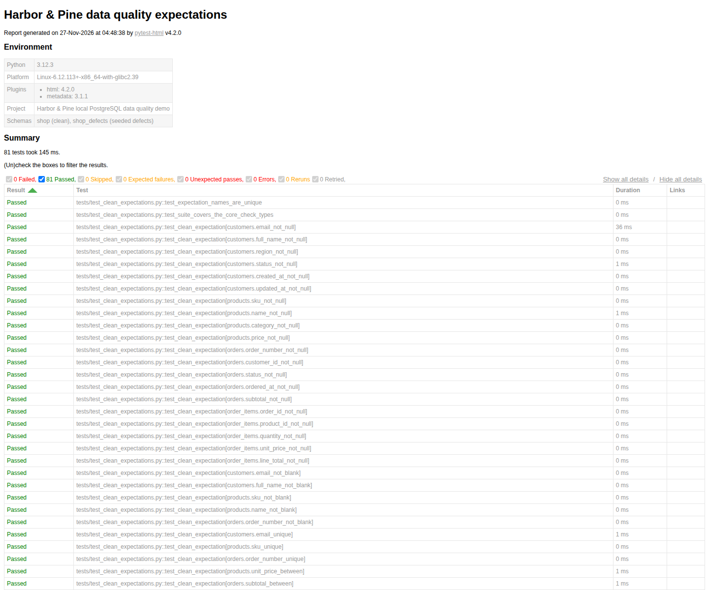

# PostgreSQL Data Quality Expectations

Portfolio demo of warehouse-style data quality checks against a local PostgreSQL staging database. Harbor & Pine is a fictional outdoor retailer. This is not employer code, and it does not connect to a production warehouse or a hosted cloud database.

[](https://github.com/Potucky/postgres-data-quality-expectations/actions/workflows/ci.yml)

[Live test report](https://potucky.github.io/postgres-data-quality-expectations/)

## What this project demonstrates

- Data QA rules for a staging load: completeness, business-key uniqueness, numeric ranges, accepted values, referential integrity, row-count thresholds, freshness, date order, and order-to-line reconciliation.
- Negative testing. `shop_defects` is seeded with known bad rows, and the tests assert the failing check, the unexpected count, and a sample value.
- An expectation suite in YAML, executed by a small Python runner and pytest, with the SQL visible in the runner instead of hidden behind a framework.
- A repeatable local setup: pinned requirements, connection settings from the environment, Docker Compose, and a loader that refuses to reset anything except the documented localhost demo.
- GitHub Actions CI that starts PostgreSQL, runs the suite on pull requests and on `main`, and uploads the HTML and JUnit reports. Pushes to `main` also publish the HTML report to GitHub Pages.

## Tech stack

- Python 3.12, pytest, pytest-html
- psycopg 3
- PostgreSQL 16 (official Docker image)
- YAML for the clean-schema contract
- GitHub Actions for CI and GitHub Pages

## Local database

PostgreSQL here is a local stand-in for the kind of staging table a data QA engineer would check in a warehouse. It is not Snowflake, BigQuery, or a hosted cloud database.

Docker Compose runs `postgres:16` with demo settings that are safe only on a laptop:

| Setting | Value |
| --- | --- |
| Host | `localhost` |
| Database | `shop` |
| User | `dq_demo` |
| Password | `dq_demo_local_only` |

`dq_demo_local_only` is a local demo password, not a secret. Do not reuse it. The loader drops and recreates `shop` and `shop_defects`, and it will refuse to do that unless the host is localhost and the database, user, and password match this table.

The tables use surrogate primary keys and indexes on the columns that behave like foreign keys. Business rules are not database constraints. That is deliberate: a staging load can land bad rows, and the suite is what catches them.

## Project structure

```text
config/expectations.yml     Clean-schema contract (49 expectations)
sql/01_schema.sql           shop and shop_defects
sql/02_seed.sql             Fictional retail data, plus the defect fixture
src/dq_runner/              Connection, loader, and expectation SQL
tests/test_clean_expectations.py
tests/test_defect_detection.py
docker-compose.yml          Local PostgreSQL 16
.github/workflows/ci.yml    Tests plus HTML and JUnit artifacts
.github/workflows/pages.yml Publish the HTML report on main
docs/test-report.png        Report from a real local run
```

## How to run locally

```bash
python3 -m venv .venv
source .venv/bin/activate
pip install -r requirements.txt
docker compose up -d --wait
pytest --html=reports/report.html --self-contained-html --junitxml=reports/junit.xml
```

Defaults match the Compose file, so a `.env` is optional. Copy `.env.example` if you want the variables spelled out. `pytest` rebuilds both schemas before the tests. To load the data without running the suite:

```bash
python scripts/load_data.py
```

Stop the database with `docker compose down`.

## Test approach

The clean contract in `config/expectations.yml` is parametrized into one pytest case per expectation. All of those must pass on `shop`.

`tests/test_defect_detection.py` points the same runner at `shop_defects` and checks that specific seeded problems fail: a null email, a whitespace email, a duplicate email and SKU, a price of `-12.50`, an unknown status, an orphan customer and product, a future `ordered_at`, a shipment timestamp before the order, a 30-day-old freshness fixture, a line total that is not quantity times price, a subtotal that does not match its lines, and a customer table below the volume contract.

Order and customer timestamps in the seed use `now()`, so the freshness check does not rot. Tests do not sleep. The only wait is a bounded connection retry while Postgres starts.

## Test report



CI uploads `reports/report.html` and `reports/junit.xml` as the `data-quality-report` artifact. On a push to `main`, the Pages workflow runs the suite again and deploys `index.html` plus the HTML report.

GitHub Pages has to be enabled once under Settings → Pages, with Source set to GitHub Actions. The live report link is the Pages site for this project.

## Author

Vasyl Popovich, QA Automation Engineer, Miami, FL. GitHub: https://github.com/Potucky
